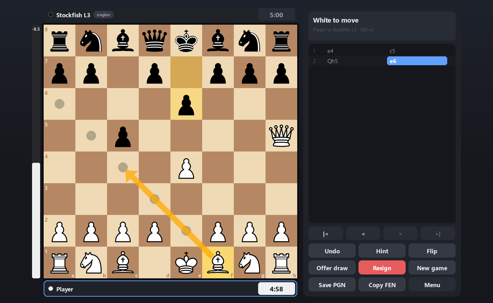

# Chess2D

[](https://www.python.org/)
[](https://stockfishchess.org/)
[]()

<div align="center">
  
  <h3>A modern, resizable 2D chess game: play Stockfish, Claude or any LLM, a friend on the same screen, or a friend online.</h3>
</div>



## Features

**Opponents**
- **Stockfish 17.1** (bundled) with 10 strength levels from ~800 to 3000+ Elo
- **Claude** (Anthropic API): Opus 5.5 / Sonnet 5.5 / Haiku 5.5 / Fable 5.1, with adjustable thinking effort; Claude comments on its moves
- **Any OpenAI-compatible LLM**: Ollama, LM Studio, OpenAI, OpenRouter, Groq, Gemini…
- **Any mix**: human vs AI, AI vs AI (e.g. Claude vs Stockfish), two humans on one screen
- **Online multiplayer** over LAN or the internet: host/join, clocks synced, draw/rematch offers, chat

**Game**
- Full rules via [python-chess]: castling, en passant, promotion picker, checkmate, stalemate, 50-move, threefold repetition, insufficient material
- Time controls (bullet → classical) with increments
- Undo / takeback, hints (best-move arrow), resign, offer draw (the AI decides based on the evaluation)
- Live **evaluation bar** powered by Stockfish
- **Review mode**: click any move or use ← → to step through the game
- **PGN export/import**, FEN import, copy FEN, and import of old Chess2D `.txt` move logs
- Unfinished games are saved automatically: **Continue last game** from the menu

**Interface**
- Freely **resizable window** (portrait and landscape layouts), F11 fullscreen, high-DPI aware
- Crisp SVG pieces rendered at any size, smooth move animation, drag-and-drop or click-to-move
- Legal-move dots, last-move and check highlights, right-click arrows and square marks (lichess style)
- 7 board themes, captured pieces and material balance, sound effects with volume control

## Install (Windows)

Download and run **`Chess2D-Setup-<version>.exe`** (built by `build.ps1`, see below). No admin rights needed.
Uninstall from *Settings → Apps*.

## Run from source

```bash
pip install -r requirements.txt     # pygame-ce, chess, anthropic, requests
python Chess2D.py                   # or: python -m chess2d
```

> `pygame-ce` replaces `pygame`. If you have the classic `pygame` package installed, run `pip uninstall pygame` first.

The Windows Stockfish binary is in `stockfish/`. On Linux/macOS install Stockfish (`apt install stockfish`, `brew install stockfish`) or set its path in **Settings**.

## Playing against Claude

1. Get an API key at [console.anthropic.com](https://console.anthropic.com/).
2. Paste it in **Settings → Claude · Anthropic API** (or set the `ANTHROPIC_API_KEY` environment variable).
3. Pick the model and thinking effort, press **Test Claude connection**, then **Play vs Claude**.

Each move is one API request and is billed to your account. Higher effort plays stronger but slower. Claude gets the position, the move list and the list of legal moves. If it replies with an illegal move it is told so and asked again (up to 3 times).

## Playing against other LLMs

In **Settings → Other LLM**, set the base URL and model of any OpenAI-compatible server, for example:

| Provider | Base URL | Model example |
|---|---|---|
| Ollama (local) | `http://localhost:11434/v1` | `llama3.1`, `qwen3` |
| LM Studio (local) | `http://localhost:1234/v1` | the loaded model |
| OpenAI | `https://api.openai.com/v1` | `gpt-5` |
| OpenRouter | `https://openrouter.ai/api/v1` | `meta-llama/llama-3.3-70b-instruct` |

Then pick **LLM (OpenAI-compatible)** as a player in *Custom match*.

## Online multiplayer

- **Host:** *Online · Host a game*, choose your colour and time control, then press *Start hosting*. Give your opponent the address shown. Allow Chess2D through the Windows firewall when asked.
- **Join:** *Online · Join a game*, enter the host's address (`ip` or `ip:port`) and press *Connect*.
- On the same network it just works. Over the internet the host must forward TCP port **5555** (configurable) on their router, or both players can use a VPN such as Tailscale or ZeroTier.

## Controls

| Action | Input |
|---|---|
| Move | drag & drop, or click piece then target |
| Draw arrow / mark square | right-drag / right-click (left-click clears) |
| Step through moves | ← → (Home / End) |
| Flip board · Hint · Undo | F · H · Ctrl+Z |
| Save PGN · Copy FEN | Ctrl+S · Ctrl+C |
| Fullscreen | F11 or Alt+Enter |

## Build the installer

Requires Python 3.10+ and [Inno Setup 6](https://jrsoftware.org/isinfo.php) (`winget install JRSoftware.InnoSetup`).

```powershell
powershell -ExecutionPolicy Bypass -File build.ps1
```

This creates `dist\Chess2D\Chess2D.exe` (PyInstaller), self-tests it, and packages `dist\Chess2D-Setup-<version>.exe`.

## Tests

```bash
python tests/test_chess2d.py        # or: python -m pytest tests
```

The tests cover rules flow, undo against AI, PGN/legacy-log import, LLM reply parsing, a loopback online game (moves, chat, draw offer, disconnect), Stockfish vs Stockfish, and a headless UI smoke test at several window sizes.

## Project layout

```
Chess2D.py              entry point
chess2d/
  app.py                window, main loop, game lifecycle, file dialogs
  game.py               game controller: turns, clocks, results, network sync, undo
  players.py            Human / Remote / Stockfish / LLM players (threaded)
  llm.py                Claude (Anthropic SDK) and OpenAI-compatible backends
  engine.py             Stockfish discovery, strength levels, background analyser
  network.py            TCP host/join, JSON-lines protocol
  pgnio.py              PGN/FEN/legacy log import & export, autosave
  settings.py, paths.py, theme.py, assets.py
  ui/                   widgets, board view, menu/setup/settings/online and game screens
pieces/ sound/ stockfish/   assets (Stockfish is GPLv3, see stockfish/SOURCE.md)
installer/Chess2D.iss   Inno Setup script
build.ps1               build exe + installer
```

Settings and the autosave live in `%APPDATA%\Chess2D` (Windows), `~/Library/Application Support/Chess2D` (macOS) or `~/.config/chess2d` (Linux). The Anthropic API key, if entered, is stored there in plain text.

## Credits

- [Stockfish](https://stockfishchess.org/) (GPLv3)
- [python-chess] by Niklas Fiekas
- [pygame-ce](https://pyga.me/)
- Piece set: Uray M. János, based on the Wikimedia Commons chess pieces (CC BY-SA)

[python-chess]: https://python-chess.readthedocs.io/
